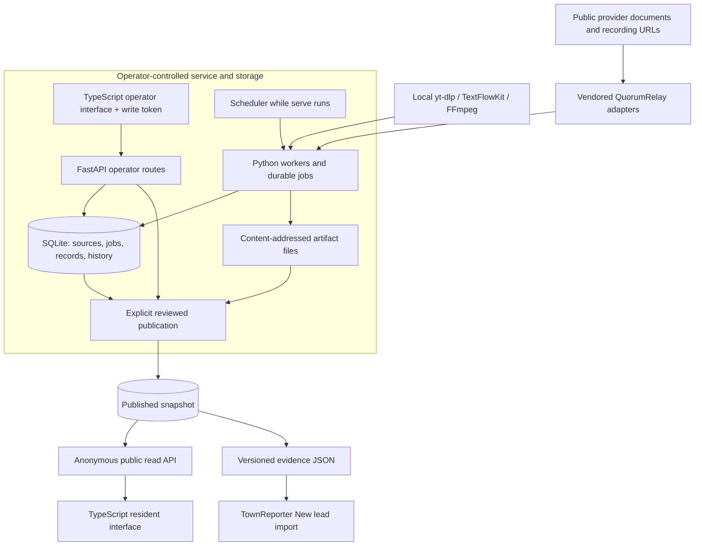
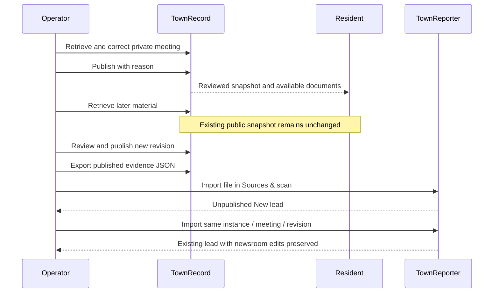
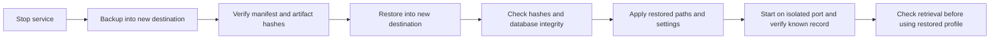

# TownRecord technical manual

This describes the maintained Windows community-record service. For operation,
start with the [user manual](USER-MANUAL.md) and [Windows setup](WINDOWS-COMMUNITY-OPERATIONS.md).
For exact installed observations and package identity, see
[acceptance](COMMUNITY-ACCEPTANCE.md). The broader [specification](SPEC.md) remains
reference/backlog. A green test run is not evidence of every provider working live.

## Architecture and trust boundary



Python owns API, storage, workers, migrations, scheduling and managed-tool jobs.
Strict TypeScript compiles to the browser asset served by Python. There is no
Tauri runtime and no Node runtime dependency for operators. QuorumRelay is pinned
and vendored; there is no separate connector service to start. The marketing
website is a separate static build and never connects to a production database.

Source entry points:

| Responsibility | File or directory |
|---|---|
| CLI, lifecycle and backup/restore entry points | `core/src/townrecord/cli.py` |
| Worker and scheduler composition | `core/src/townrecord/service.py` |
| Runtime environment | `core/src/townrecord/config.py` |
| App factory and private API documentation | `core/src/townrecord/api/app.py` |
| Token boundary | `core/src/townrecord/api/auth.py` |
| Operator and resident endpoints | `core/src/townrecord/api/community.py` |
| Connector facade | `core/src/townrecord/api/connectors.py` |
| Ordered SQLite migrations | `core/src/townrecord/db/migrations/` |
| Browser source and compiler configuration | `frontend/community.ts`, `frontend/tsconfig.json` |
| Packaged HTML, CSS and generated JavaScript | `core/src/townrecord/web/` |

## Build and development

Use Python 3.12+, uv, Node 22 and npm. From the repository root:

```powershell
npm ci
npm run check:ui
npm run build:ui
uv sync --project core --locked
uv run --project core ruff check core
uv run --project core ruff format --check core
uv run --project core pytest core/tests
uv build core --wheel
```

Generated `community.js` is committed and included in the wheel. CI recompiles
it and rejects a diff. Run the service using the private profile settings in the
Windows guide; `townrecord serve` owns workers and scheduling. The API-only
`python -m townrecord.api` development entry point does not provide that complete
operational lifecycle. Never point a development/test instance at a production
profile, or run two service owners against the same profile.

The [website guide](SITE.md) covers its separate zero-dependency static build,
preview and approval-held deployment. Website work does not require rebuilding
the accepted wheel. The existing CI matrix remains unchanged; it does not imply
new operating-system packages or installed acceptance on those systems.

## Configuration

Set these in a private start script before creating tokens and serving. Defaults
are from `Settings.from_env`; prefer explicit profile paths in operation.

| Variable | Default | Purpose |
|---|---|---|
| `TOWNRECORD_DB` | `~/.townrecord/townrecord.db` | SQLite file |
| `TOWNRECORD_STORAGE` | `~/.townrecord/storage` | Artifact root |
| `TOWNRECORD_RUNTIME_ROOT` | `~/.townrecord` | Managed runtime parent |
| `TOWNRECORD_HOST` | `127.0.0.1` | Bind address |
| `TOWNRECORD_PORT` | `8190` | HTTP port |
| `TOWNRECORD_ALLOW_LAN` | false | Explicit permission to bind beyond loopback |
| `TOWNRECORD_TIME_ZONE` | empty | IANA timezone; required for usable daily schedule |
| `TOWNRECORD_DAILY_TIME` | `06:00` | Local daily scan time, HH:MM |
| `TOWNRECORD_TEST_VIDEO` | empty | Known accessible recording for tool checks |

Malformed daily time falls back to the default in this implementation; configure
it deliberately and confirm status rather than assuming arbitrary input was used.
The service must remain running for scheduled retrieval. It does not register a
Windows startup task or wake the machine. Managed LAN access requires explicit
configuration and an IT-managed HTTPS boundary; the service does not provision TLS.

## Authentication and HTTP integration

Create a named token with `townrecord token create --name NAME --scope write`
under the intended profile. The CLI's `write` maps to `read_write`. Read tokens
cannot perform writes, and the operator workspace requires write scope. Tokens
are printed once and stored hashed. The browser keeps the supplied token in
memory, not a resident URL. Do not put credentials in examples or source control.

| Surface | Access and use |
|---|---|
| `/`, `/operator`, two allowlisted browser assets | Public page shells; operator data still requires token |
| `GET /public/v1/bodies` | Published body listing |
| `GET /public/v1/meetings` | Published search with `q`, `body_id`, `date_from`, `date_to` |
| `GET /public/v1/meetings/{id}` | Reviewed meeting snapshot |
| `GET /public/v1/meetings/{id}/documents/{record_id}` | Document belonging to that publication |
| `/v1/operator/overview`, `/v1/operator/meetings` | Private operator reads |
| `PATCH /v1/operator/meetings/{id}` | Metadata correction with reason |
| `POST /v1/operator/meetings/{id}/publish` or `/withdraw` | Explicit publication transition with reason |
| `GET /v1/operator/meetings/{id}/handoff` | Published evidence export for downstream use |
| `/v1/connectors/*` | Private capabilities, configuration, jobs and provider-dependent operations |
| `/openapi.json`, `/docs`, `/v1/health` | Token-protected schema, documentation and health |

Example reads (PowerShell; obtain `$token` privately without logging it):

```powershell
$base = 'http://127.0.0.1:8190'
Invoke-RestMethod "$base/public/v1/meetings?q=budget"
$headers = @{ Authorization = "Bearer $token" }
Invoke-RestMethod "$base/v1/health" -Headers $headers
Invoke-RestMethod "$base/openapi.json" -Headers $headers
```

Use the running OpenAPI schema for exact request fields and responses. A normal
browser address-bar navigation to private `/docs` cannot supply the bearer header;
use an authenticated HTTP client to retrieve the schema. TownRecord exposes HTTP
and JSON; this documentation does not claim a dedicated TownRecord MCP server.
Connector discovery/export/write-back remain provider-capability-dependent. See
[CONNECTORS.md](CONNECTORS.md) rather than assuming a catalog entry supports every operation.

## Publication and downstream identity



Snapshots separate acquisition from publication. Corrections and association
changes carry reasons/history. Withdrawal removes current public access, not
internal history or remote copies. Source text, machine origin and provisional
status must survive export. The TownReporter receiver enforces an 8 MiB UTF-8
payload limit and validates the evidence before creating a lead. It does not
trigger generation or publication. Stable instance identity survives restore and
is part of duplicate handling. Full Council and Planning payloads passed both
receiver tests and browser import; see the receipts for exact observations.

## Storage, recovery and operations

SQLite migrations run when the service opens the database. Preserve the database
and referenced artifact tree together; an isolated DB copy is not a complete
backup. Immutable artifacts are content-addressed and backup/restore verifies
their hashes. Source configuration, publication history, token hashes, instance
identity and scheduling settings belong to the recoverable profile.



The [Windows operations guide](WINDOWS-COMMUNITY-OPERATIONS.md#backup-and-recovery)
is the canonical command procedure. External provider credentials and managed
program/model caches are not copied; preserve credentials separately and reinstall
tools. Both backup and restore reject an existing destination. Preserve the old
profile until recovery is verified. Backups contain private unpublished material.

`townrecord status` reports schedule/source state. Investigate paused causes and
job failures before retrying. Provider access, redirect origins, missing tools and
missing timezone are different failures. Local transcription uses managed yt-dlp
and TextFlowKit plus FFmpeg; Whisper small may consume significant CPU and disk.
No guaranteed network bypass or universal caption availability is promised.

## Evidence and maintenance

The accepted package source is `758abf6fa4a0f629bc2c54a4dd937ade423f364a`;
its complete identity and SHA-256 are in [acceptance](COMMUNITY-ACCEPTANCE.md).
Implementation PR43 and handoff PR44 merged; post-merge CI run `43521706630`
passed. Later documentation does not change the accepted wheel bytes.

Tests cover identity/reschedule/document revision, publication isolation,
association corrections, lifecycle, receiver validation and recovery. Installed
observations cover the bounded Windows flows. Live retrieval, synthetic staged
arrival, model comparison and full local transcription are distinct evidence
tiers, not interchangeable claims. The [handoff](COMMUNITY-COMPLETION-HANDOFF.md)
records delivery, cleanup, approval holds and current documentation progress.
