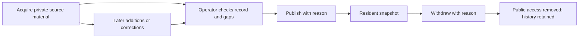

# TownRecord user manual

TownRecord helps a community keep a searchable record of public meetings. An
operator collects source documents and transcripts, checks them, and publishes
a reviewed snapshot. Residents can read that snapshot without an account.
TownRecord is part of the Townlight umbrella. This manual covers the tested
Windows community-record candidate, not every feature in the wider specification.

**Start here:** [Windows installation and recovery](WINDOWS-COMMUNITY-OPERATIONS.md)
for the person running the service; [resident instructions](#for-residents) for
readers; [technical manual](TECHNICAL-MANUAL.md) for developers and IT.
The [acceptance record](COMMUNITY-ACCEPTANCE.md) identifies the exact tested
package. [Download the 0.1.0 community preview](https://github.com/scottconverse/townrecord/releases/tag/v0.1.0).
Scott approved publication of the unchanged tested candidate on November 13, 2026.

## Before the first meeting

An operator needs a running TownRecord service, its URL and a named write token.
The Windows guide provides the exact installation, profile and token commands.
This is currently a Python service with a browser interface, not an MSI app.
Node is needed only to build the interface from source. Keep the service console
open for background retrieval. On the host computer the default addresses are
`http://127.0.0.1:8190/operator` and `http://127.0.0.1:8190/`.

For other computers, IT must provide a reachable community URL and HTTPS for
operator access. A localhost address always points to the reader's own computer.
There is no automatic public hosting, domain setup or Windows startup service.

1. Open the operator workspace and enter your write token. It is held in browser
   memory; sign out when finished, especially on a shared computer. Store the
   original token in your password manager, not in a shared document or URL.
2. Create the community and public bodies with names matching their source.
   The accepted pilot used Longmont City Council and Planning and Zoning Commission;
   it does not imply a city endorsement or partnership.
3. Add the supported source URL, provider and coverage dates. Document downloads
   may use a separate storage origin; enter only the exact verified origin.
   For the observed Longmont PrimeGov source these were
   `https://longmont.primegov.com` and `https://pgwest.blob.core.windows.net`.
4. Validate and save the source, then retrieve the selected coverage. Check the
   result, not just the fact that the job was queued. Bodies outside the selected
   coverage are skipped rather than silently treated as imported.

See [connector capabilities and limits](CONNECTORS.md) before choosing another
provider. A listed format is not a guarantee of live access to every customer site.

## A daily operator session

Check Processing for failed or paused work. Review each meeting's title, body,
date, source links, documents and recording. Open the original document when
extracted text is missing or looks wrong. A document named “Minutes” is not proof
that the body approved it. Scanned or incomplete source material can remain a gap.

| What you see | What to do |
|---|---|
| Work queued or running | Wait for its terminal result before claiming acquisition. |
| Paused or failed work | Read the reason, resolve that cause, then use retry. |
| Wrong title, date, body or cancellation/continuation information | Correct the meeting and record a reason. Check its history. |
| Document or recording attached to the wrong meeting | Choose the correct destination and give a reason. A moved recording becomes the destination's primary recording. |
| Missing recording, captions or document text | Keep the gap visible; check the publisher and source details. Do not substitute invented text. |
| New source material after publication | Review it and explicitly republish; retrieval alone does not change the public snapshot. |

Daily retrieval runs at the configured local time while the service is running.
The scheduled window is 30 days back and 60 days ahead; explicit manual retrieval
uses the chosen coverage dates. The service does not wake a sleeping computer.

## Captions and local transcription

Source captions are evidence supplied by the source, not certified minutes.
When they are missing or unsuitable, the operator can create a local transcript
for the recording. Under Processing, set up/check yt-dlp and TextFlowKit. FFmpeg
must also be available as described in the installation guide. Initial setup and
the first model download require internet access and storage.

Choose **Create local transcript**, provide a reason, and check the resulting
job. This candidate uses Whisper small through TextFlowKit on the local machine.
Audio is not sent to a hosted transcription provider by that path. Transcription
can take substantial CPU time; a failed download or unfinished job is not a
transcript. Playback and caption access depend on the publisher and network.

Review names, numbers and decisions against the recording. Machine-generated
text remains provisional and visibly labeled when published. The
[Whistle/Whisper comparison](TRANSCRIPTION-COMPARISON.md) explains the choice;
it is a bounded comparison, not a general accuracy guarantee.

## Publish, correct and withdraw

Publish only the reviewed meeting, with a reason. Publication captures the
meeting, selected document content and transcript. Later private changes do not
silently replace it. To correct public information, review the revised record and
publish again. Withdrawal removes current resident access and document downloads;
it retains internal history and cannot recall files already downloaded elsewhere.

## For residents

1. Open the community's TownRecord URL. No resident account is required.
2. Browse meetings or filter by public body and date. Search a topic to find it
   in available published text. Missing text cannot produce a search hit.
3. Open a meeting to read its documents and available transcript. Use original
   source links to check provenance and download available published documents.
4. Follow a transcript or agenda timestamp to the original recording. An agenda
   item without a recorded time cannot offer a precise recording position.
5. Share the meeting URL (`/?meeting=ID`) using the community's reachable server
   address. A withdrawn record will no longer be available there.

Machine text is not an official account of a vote or a certified transcript.
Consult the original recording and approved records when accuracy matters. Report
an apparent error to the community's operator with the meeting URL, document or
timestamp and proposed correction. This candidate has no resident correction form.

## Export a meeting to TownReporter

After publication, use the meeting's evidence export. In TownReporter, open
**Sources & scan**, select the TownRecord evidence file and import it. The accepted
integration creates an unpublished **New lead**; it does not write or publish an
article, start a scan or call a model. The evidence preserves source links,
published revision and available full text and timestamps.

Importing the same revision returns the existing lead and preserves newsroom
edits. Changed evidence requires a newly published revision. The receiver accepts
at most 8 MiB of UTF-8 evidence JSON. If rejected, read the validation message;
do not rename arbitrary files to JSON or strip provenance to force acceptance.
TownReporter is separate software, not bundled into the TownRecord service.

## Recovery and troubleshooting

| Problem | Next action |
|---|---|
| Page does not open | Check that the service console is running and that you used its host/port. |
| Operator access rejected | Use the correct named write token; public pages do not grant operator access. |
| A source download is rejected | Verify the source and exact download origin. Do not allow arbitrary hosts. |
| A transcript job fails | Read its reason; check recording access and managed tools/FFmpeg before retrying. |
| Newly retrieved content is absent publicly | Review and republish the meeting. |
| Resident cannot open your link | Replace a loopback URL with the community URL configured by IT. |
| Retrieval did not run overnight | Check service uptime, timezone, daily time and paused causes using `townrecord status`. |

Back up before changes and on the community's chosen schedule. Stop the service,
use the verified backup command, and protect the backup as private information.
It includes unpublished material. Restore into a new directory, retain the old
profile, and check a known meeting and retrieval before using the restored copy.
The [Windows operations guide](WINDOWS-COMMUNITY-OPERATIONS.md#backup-and-recovery)
contains the exact commands and explains what is not included.

## What was actually verified

Real two-body acquisition, full source captions, operator corrections, resident
navigation, a full 98-minute local transcription, two full TownReporter browser
imports, scheduling and backup/restore passed in isolated Windows acceptance.
Synthetic fixtures cover staged agenda/recording/minutes arrival and republication.
These do not establish every provider, human transcript certification, city adoption
or months of unattended operation. See the linked acceptance record for identities
and distinctions. Scott decides whether any further human trial is required.
